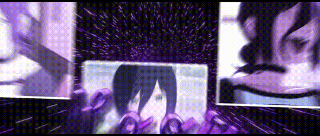
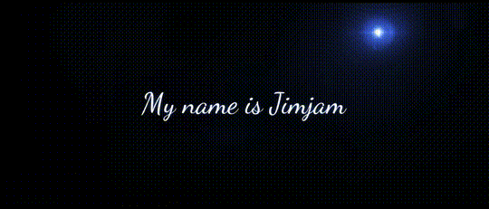
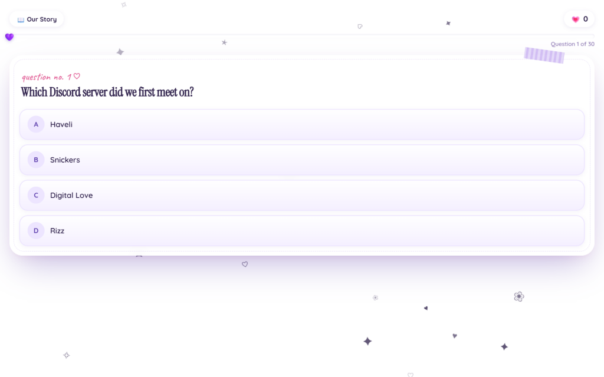
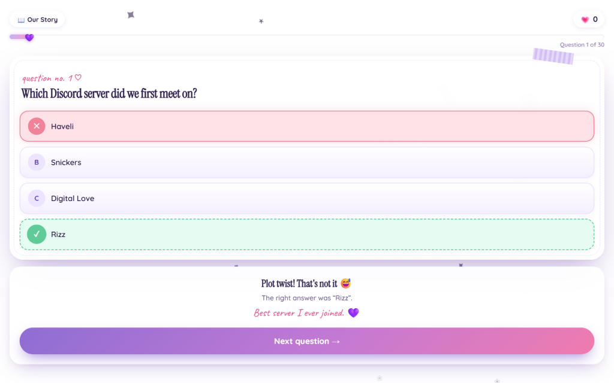
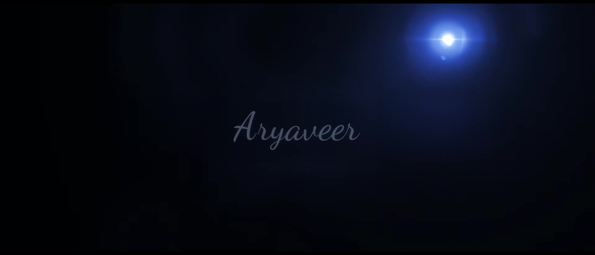

<div align="center">

# 🌸 KIZUNA (絆)
### Story-Driven Visual Dialogue Engine & Interactive Memory Architecture
*Engineered with Svelte 5 (Runes), TypeScript, Vite, Tailwind CSS 4 & Web Audio API*

<br/>

[](https://svelte.dev/)
[](https://www.typescriptlang.org/)
[](https://vitejs.dev/)
[](https://tailwindcss.com/)
[](https://developer.mozilla.org/en-US/docs/Web/API/Web_Audio_API)

<br/>

[Live Preview](#-visual-walkthrough) • [Cinematic Showcase](#-cinematic-motion--gameplay) • [System Architecture](#-system-architecture--state-machine) • [Interactive Workflows](#-interactive-engine-workflows) • [Engineering Highlights](#-engineering-highlights) • [Getting Started](#-getting-started)

<br/>

### 🎬 Live Animated Experience


</div>

---

## 📌 Overview

**Kizuna (絆)** — *translating to the enduring emotional bond between individuals* — is an interactive, cinematic web experience that merges visual-novel narrative engines with dynamic trivia systems, ambient audio reactive transitions, and unlockable memory vaults.

Built from the ground up utilizing the latest **Svelte 5 Runes state architecture (`$state`, `$derived`, `$effect`)**, Kizuna delivers ultra-smooth 60fps animations, reactive font typography switches, typewriter-style dialogue streaming, and client-side audio DSP synchronization.

---

## 🎥 Cinematic Motion & Gameplay

<div align="center">

| 🌸 1. Dynamic Quiz Ambience | 🎭 2. Cinematic Story Transition |
| :---: | :---: |
|  |  |
| *Real-time looping ambient video canvas backdrop* | *Atmospheric visual dialogue transitions and particle loops* |

</div>

---

## 📸 Visual Walkthrough

<div align="center">

| 📝 1. Active Trivia Quiz Questions | ✅ 2. Real-Time Feedback & Dialogue Reaction |
| :---: | :---: |
|  |  |
| *Clean question cards, category metadata, and choice buttons* | *Dynamic answer validation, reaction dialogue, score calculation* |

| 🎭 3. Cinematic 1080p Story Stage | 🔐 4. Passcode Vault & Memory Reveal |
| :---: | :---: |
|  |  |
| *High-res 2.5K anime cinematic story backdrop* | *Cipher-protected wax-seal envelope with secret memory letter* |

</div>

---

## 🔄 System Architecture & State Machine

```
                           ┌────────────────────────────────────────┐
                           │            App Initializer             │
                           │     (Asset Preloader & Audio Buffer)   │
                           └───────────────────┬────────────────────┘
                                               │
                                               ▼
                           ┌────────────────────────────────────────┐
                           │          Loading & Quote State         │
                           │   (Canvas Particle Simulation Engine)  │
                           └───────────────────┬────────────────────┘
                                               │
                                               ▼
                           ┌────────────────────────────────────────┐
                           │     Visual Novel Dialogue Engine       │
                           │   - Typewriter Stream ($state)         │
                           │   - Branching Story Choice Nodes       │
                           │   - Auto-advance Toggle Engine         │
                           └───────────────────┬────────────────────┘
                                               │
                                               ▼
                           ┌────────────────────────────────────────┐
                           │       Interactive Memory Trivia        │
                           │   - Real-time Category Matrix          │
                           │   - Immediate Sound FX (.wav) Feedback │
                           │   - Dynamic Score Tier Calculation     │
                           └───────────────────┬────────────────────┘
                                               │
                                               ▼
                           ┌────────────────────────────────────────┐
                           │       Secret Memory Vault (Vault)      │
                           │   - Passcode Cipher Verification       │
                           │   - Wax-Seal Envelope Unfold Animation │
                           │   - Ambient BGM Crossfade              │
                           └────────────────────────────────────────┘
```

---

## ⚡ Interactive Engine Workflows

### 1. Trivia & Evaluation Pipeline
```
[Question Presented] ──► [Select Option] ──► [Sound Dispatcher: Correct/Wrong WAV]
                                   │
                                   ▼
                         [Compute Weighted Score]
                                   │
                                   ▼
                         [Render Result Badge Tier]
```

### 2. Dialogue & Story State Flow
```
[User Input / Auto-Timer] ──► [Dialogue Context ($state)] ──► [Typewriter Character Streamer]
                                         │
                                         ▼
                            [Trigger Audio FX & Scene Shift]
```

### 3. Passcode Gated Vault Decryption
```
[Passcode Entry] ──► [Input Hash Comparison] ──► [Wax Seal Break Animation] ──► [Reveal Secret Memory Letter]
```

---

## 🔬 Engineering Highlights

### ⚡ Svelte 5 Fine-Grained Reactivity (Runes)
- Migrated away from legacy Svelte 4 store patterns to **Svelte 5 Runes** (`$state`, `$derived`, `$props`). This eliminates virtual DOM reconciliation overhead and allows fine-grained micro-updates on the DOM tree during rapid text streaming.

### 🎧 Ambient Audio Crossfading & Reactive Sound Engine
- Engineered an audio pipeline that smoothly transitions between background scores (`love-bgm` and `quiz-bgm`) without abrupt audio cuts.
- Low-latency interactive response sounds (`1.wav` to `10.wav`) fired instantaneously on user clicks and validation states.

### 🎨 Typography & Particle Atmosphere
- Integrates multiple custom cursive and serif fonts (`DancingScript`, `AlexBrush`, `Courgette`, `KaushanScript`, `Parisienne`) dynamically swapped per character emotional state.
- GPU-accelerated background particle effects using `@tsparticles/basic`.

---

## 🧰 Tech Stack Matrix

| Domain | Technology |
|---|---|
| **Core Framework** | Svelte 5 (Runes Architecture), SvelteKit |
| **Language** | TypeScript 5 (Strict Mode) |
| **Styling & Design** | Tailwind CSS 4, Custom CSS Animations, Typography suite |
| **Audio Processing** | Web Audio API, HTML5 Audio Controllers |
| **Visual Effects** | `@tsparticles/basic` Canvas Particle System |
| **Build System** | Vite 8, Vercel Adapter |

---

## 🚀 Getting Started

### Prerequisites
- Node.js `>= 18.0.0`
- npm, pnpm, or bun

### 1. Clone the repository
```bash
git clone https://github.com/ansh44233/kizuna.git
cd kizuna
```

### 2. Install dependencies
```bash
npm install
```

### 3. Run development server
```bash
npm run dev
```

Visit **`http://localhost:5173`** in your browser.

---

## 👨‍💻 Author & Rights
**ansh44233**
- GitHub: [@ansh44233](https://github.com/ansh44233)
- Project Repository: [https://github.com/ansh44233/kizuna](https://github.com/ansh44233/kizuna)

---

## 📄 License
This project is licensed under the [MIT License](LICENSE) © 2026 **ansh44233**. All rights reserved.

<br/>

<div align="center">
  <sub>Engineered with passion for interactive storytelling, modern reactive frontend runtimes, and atmospheric UI.</sub>
</div>
